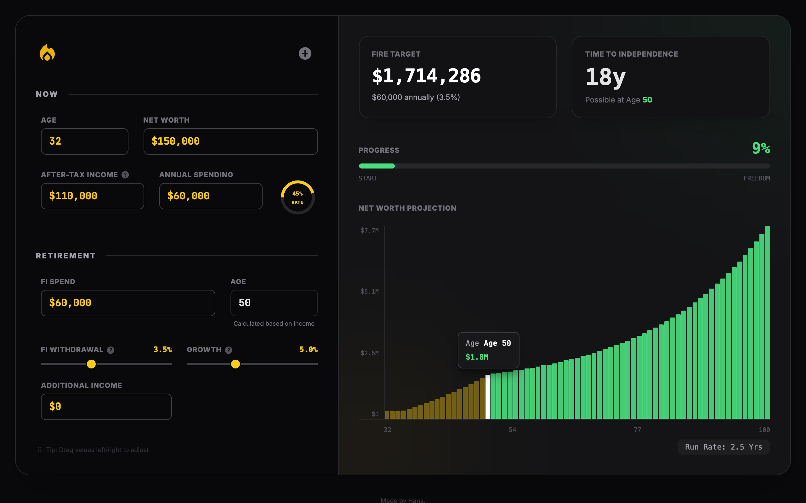
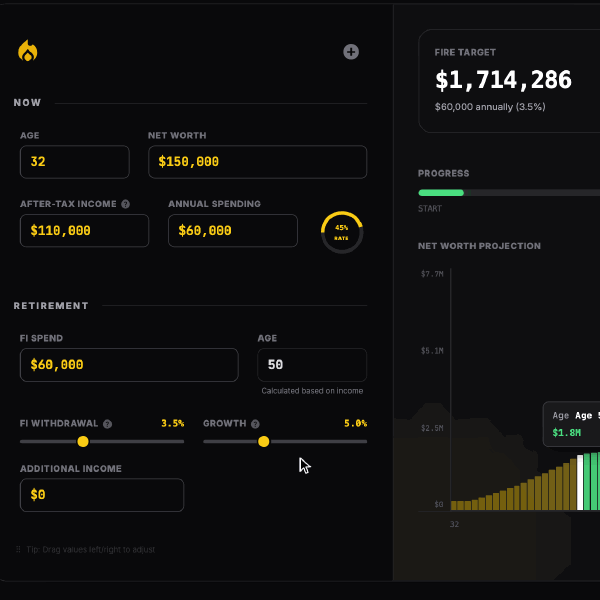
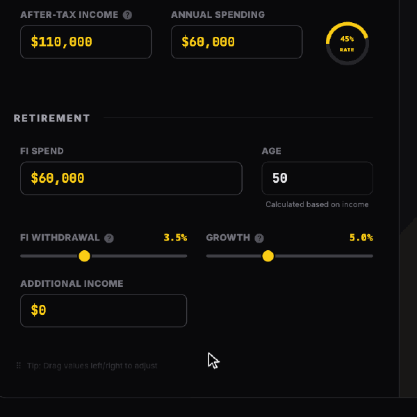
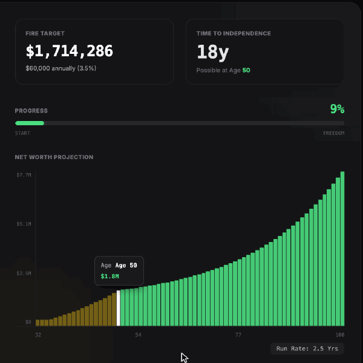

# `firecalc`

Can you retire tomorrow? Play with the numbers. Drag your numbers and watch your financial independence age, target and projection move.

  
[<kbd> haaans.com/firecalc  </kbd>](https://haaans.com/firecalc/)

## Features

<table>
<tr valign="top">
<td width="50%">
<h3>Drag any number</h3>

Every field is a scrubber. Drag spending down and your savings rate climbs, your FI age drops, and the projection redraws as you go.

</td>
<td width="50%">

</td>
</tr>
<tr valign="top">
<td width="50%">

</td>
<td width="50%">
<h3>Solve for age or for spend</h3>

Set the age you want to retire and it works out what you can spend. Set the spend you want and it works out the age.

</td>
</tr>
<tr valign="top">
<td width="50%">
<h3>Tune your assumptions</h3>

Slide the withdrawal rate and expected growth to see how much each one moves your date.

</td>
<td width="50%">

</td>
</tr>
<tr valign="top">
<td width="50%">

</td>
<td width="50%">
<h3>Read the projection year by year</h3>

Hover any year to see your projected net worth. Gold bars are the years you're still building, green are the years you're free.

</td>
</tr>
</table>
